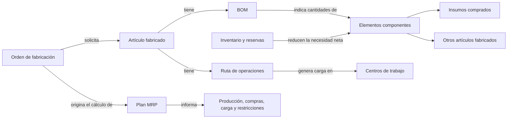
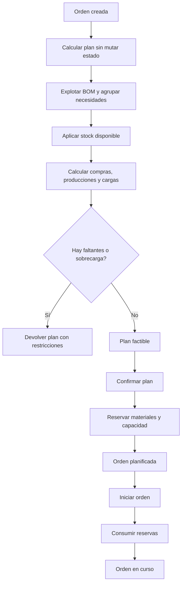

# Trabajo Práctico: Sistema de Planificación de la Producción (MRP)

## Situación Hipotética

**TecnoMecánica ITBA S.A.** fabrica equipos a partir de insumos comprados y subconjuntos producidos en la planta. La planificación actual se realiza con hojas de cálculo: ante una orden, distintas personas interpretan la lista de materiales de maneras diferentes, descuentan existencias más de una vez o descubren demasiado tarde que un centro de trabajo no tiene horas disponibles.

La empresa solicita el núcleo de un MRP simplificado. Dada una orden de fabricación, el sistema deberá calcular qué cantidades producir o comprar, qué inventario utilizar y qué carga generará en cada centro de trabajo. El cálculo se puede consultar sin alterar existencias; solo al confirmar un plan se reservan materiales y capacidad.

### Objetivo del sistema

El prototipo deberá permitir:

- registrar insumos comprados y artículos fabricados;
- definir listas de materiales sin dependencias cíclicas;
- definir las operaciones necesarias para fabricar cada artículo;
- mantener inventario y capacidad por período;
- calcular un plan para una orden sin modificar el estado;
- confirmar e iniciar una orden mediante transiciones controladas;
- informar faltantes de material y sobrecargas de capacidad.

### Modelo temporal simplificado

La planificación utiliza **períodos discretos** identificados por enteros positivos (`1`, `2`, `3`, ...). Toda la orden se analiza para un único período objetivo. No se modelan fechas, duración entre períodos ni tiempos de entrega. Esta simplificación permite concentrarse en la explosión de materiales, las reservas y la capacidad.

### Alcance y vocabulario del dominio

El vocabulario siguiente fija el significado de los conceptos, no una correspondencia obligatoria entre conceptos y clases. Ustedes deberán decidir qué objetos tienen identidad, cuáles son valores y quién coordina los cálculos.

| Concepto | Representa | Es responsable de | No es responsable de |
| --- | --- | --- | --- |
| Elemento de producción | Cualquier artículo conocido por el sistema | Código, descripción y existencias | Decidir por sí solo cuánto comprar o producir |
| Insumo comprado | Un elemento adquirido a un proveedor | Costo unitario de compra | Tener BOM u operaciones de fabricación |
| Artículo fabricado | Un elemento producido en la planta | Su BOM y su ruta de operaciones | Mantener la capacidad de los centros utilizados |
| Línea de BOM | El uso de un componente dentro de un artículo padre | Componente y cantidad por unidad del padre | Mantener inventario |
| Operación | Un paso de la ruta de un artículo fabricado | Orden, centro requerido y horas por unidad | Reservar capacidad por sí sola |
| Centro de trabajo | Un recurso productivo, como Corte o Pintura | Capacidad disponible por período y costo por hora | Conocer la composición de los artículos |
| Orden de fabricación | El pedido de producir cierta cantidad de un artículo | Producto, cantidad, período objetivo y estado | Recalcular o mutar silenciosamente un plan confirmado |
| Plan MRP | El resultado de calcular una orden | Producciones, compras, uso de stock, cargas y restricciones | Modificar inventario o capacidad mientras es solo una consulta |

Este mapa muestra relaciones del negocio, no la arquitectura de la solución. En particular, no resuelve si el plan es un objeto, un valor inmutable o el resultado de un servicio. Sí exige que consultar un escenario no modifique inventario ni capacidad.

### Cómo se calcula un plan

La orden siempre fabrica la cantidad solicitada del producto final. Para cada componente de su BOM se aplica el siguiente procedimiento:

1. Calcular la necesidad bruta: `cantidad_a_producir_del_padre * cantidad_por_unidad`.
2. Agrupar las necesidades del mismo componente antes de consultar su stock.
3. Utilizar primero el stock disponible: `stock_fisico - stock_reservado`.
4. Si falta un insumo comprado, registrar la diferencia como cantidad a comprar.
5. Si falta un artículo fabricado, registrar la diferencia como cantidad a producir y explotar su BOM recursivamente.
6. Por cada artículo que efectivamente deba producirse, calcular la carga de sus operaciones: `cantidad_a_producir * horas_por_unidad`.
7. Agrupar la carga por centro de trabajo y compararla con su capacidad disponible en el período.

### Ejemplo completo de explosión

Para fabricar una **Bomba P** se necesitan `2 Ejes E` y `3 Tornillos T`. Cada **Eje E** requiere `4 Tornillos T` y `1 Barra B`.

Se crea una orden por `2 Bombas P`. Hay `1 Eje E`, `5 Tornillos T` y `0 Barras B` disponibles, sin reservas previas.

- Deben producirse las `2 Bombas P` solicitadas.
- La necesidad bruta de ejes es `2 * 2 = 4`. Se usa el eje disponible y deben producirse `3 Ejes E`.
- Los tornillos requeridos directamente por las bombas son `2 * 3 = 6`.
- Los tres ejes que sí deben producirse requieren `3 * 4 = 12` tornillos y `3 * 1 = 3` barras.
- La necesidad total de tornillos es `6 + 12 = 18`. Luego de aplicar los `5` disponibles, deben comprarse `13 Tornillos T`.
- Deben comprarse también `3 Barras B`.

Si producir una bomba requiere `1,5` horas de Montaje y cada eje requiere `0,5` horas de Torneado, la carga resultante es de `3` horas de Montaje y `1,5` horas de Torneado. No se calcula carga por el eje tomado del inventario, porque ya fue fabricado.

### Fuera de alcance

No se requiere una interfaz gráfica, base de datos, proveedores, lotes, mermas, sustitución de componentes, tiempos de entrega, mantenimiento de máquinas, control de calidad ni asignación individual de operarios. El sistema no distribuye operaciones entre varios períodos ni optimiza fechas: informa si el único período objetivo tiene capacidad suficiente.

## Requerimientos Técnicos Obligatorios

- Implementar la solución con Programación Orientada a Objetos y separar el punto de entrada de la lógica del dominio.
- Identificar y justificar una jerarquía que permita tratar uniformemente conceptos relacionados sin perder sus diferencias de comportamiento. No se evaluará positivamente una herencia utilizada solo para cumplir el requisito.
- Modelar la BOM como relaciones entre objetos existentes; no duplicar artículos completos dentro de cada lista.
- Detectar ciclos mediante un algoritmo de recorrido explícito, sin librerías externas de grafos.
- Definir excepciones propias para datos inválidos, ciclos, transiciones ilegales y confirmación de planes no factibles.
- Encapsular inventario, reservas, capacidad y estados; no deben modificarse directamente desde el programa principal.
- Escribir pruebas unitarias con `pytest`, en especial para cálculos recursivos y ausencia de efectos secundarios.

## Reglas de Negocio

1. **Identidad y cantidades:** El código de cada elemento es único. Las cantidades de stock, BOM y órdenes son enteras; las de BOM y órdenes son positivas, mientras que el stock puede ser cero. Los costos y las horas son números no negativos, y las horas de una operación deben ser mayores que cero.
2. **Especialización válida:** Un insumo comprado tiene costo de compra y no puede tener BOM ni operaciones. Un artículo fabricado debe tener al menos una línea de BOM y una operación antes de participar en una orden.
3. **BOM consistente:** Dentro de una BOM, cada componente aparece una sola vez. Un elemento no puede ser componente directo ni indirecto de sí mismo. Al agregar una línea que forme un ciclo, el sistema la rechaza sin modificar la BOM.
4. **Ruta ordenada:** Los números de orden de las operaciones de un artículo son enteros positivos y no se repiten. La ruta se ejecuta en orden ascendente.
5. **Stock disponible:** Para planificar se considera `stock_fisico - stock_reservado`. Nunca se puede reservar ni consumir una cantidad mayor que la disponible, y ambos valores deben permanecer no negativos.
6. **Explosión neta:** El cálculo agrupa toda la necesidad bruta de un elemento, aplica una sola vez su stock disponible y explota únicamente la cantidad faltante de los artículos fabricados.
7. **Carga de capacidad:** La carga de un centro es la suma de `cantidad_a_producir * horas_por_unidad` para todas las operaciones que lo utilizan. La capacidad disponible es `capacidad_del_periodo - capacidad_reservada`.
8. **Costo unitario:** El costo de un insumo es su precio de compra. El de un artículo fabricado es la suma del costo de sus componentes por unidad más el costo de sus operaciones por unidad (`horas_por_unidad * costo_por_hora`). El cálculo es recursivo y no depende del stock actual.
9. **Cálculo sin efectos secundarios:** Calcular un plan no cambia stock, reservas, capacidad ni estado de la orden. Repetir el cálculo sobre el mismo estado produce el mismo resultado.
10. **Factibilidad y confirmación:** Un plan es factible cuando no contiene cantidades a comprar y ningún centro supera su capacidad disponible. Solo un plan factible y correspondiente al estado actual puede confirmarse; al hacerlo, se reservan materiales y capacidad y la orden pasa de `CREADA` a `PLANIFICADA`.
11. **Inicio de producción:** Solo una orden `PLANIFICADA` puede iniciarse. Al iniciar, el stock físico y sus reservas disminuyen por los materiales reservados; la capacidad reservada permanece registrada como utilizada para ese período. La orden pasa a `EN_CURSO`.
12. **Reporte de restricciones:** Un plan no factible informa cada insumo faltante con su cantidad y cada centro sobrecargado con horas requeridas, disponibles y excedidas. No debe ocultar restricciones por informar solo la primera.

### Pruebas mínimas esperadas

- rechazo de cantidades inválidas y códigos duplicados;
- explosión de una BOM de uno y de varios niveles;
- componente compartido por dos ramas, agrupado antes de aplicar stock;
- uso parcial y total del inventario;
- detección de ciclos directos e indirectos sin modificar la BOM;
- costo recursivo de insumos y operaciones;
- suma de cargas cuando varias operaciones usan el mismo centro;
- cálculo repetido sin cambios de estado;
- confirmación de un plan con faltantes o sobrecarga;
- transiciones válidas e inválidas de una orden.

### Decisiones de diseño que deberán resolver

El resultado numérico está especificado; la forma de obtenerlo queda abierta. El diseño deberá responder, entre otras, estas preguntas:

- ¿Quién garantiza que una BOM no quede en un estado inválido cuando se intenta agregar un ciclo?
- ¿Cómo se recorre una estructura de varios niveles sin confundir necesidad bruta, stock utilizado y necesidad neta?
- ¿En qué momento se agrupan componentes compartidos y qué estructura de datos sostiene esa acumulación?
- ¿Cómo se representa un plan calculado para que pueda inspeccionarse sin darle permiso para alterar inventario?
- ¿Cómo se detecta que un plan quedó desactualizado porque cambió el stock o la capacidad antes de confirmarlo?
- ¿Qué comportamientos de los elementos admiten polimorfismo y cuáles pertenecen al proceso de planificación?
- ¿Cómo se evita que el cálculo de costos y la explosión de materiales implementen dos recorridos recursivos inconsistentes?

No existe un diagrama de clases oficial para copiar. Se evaluará que el diseño pueda explicar el ejemplo, sostener las invariantes y evolucionar sin concentrar el sistema completo en una clase planificadora.

### Evolución durante el semestre

La solución se construirá por incrementos. Cada entrega debe mantener las pruebas ya obtenidas y registrar las decisiones de diseño que cambien.

1. **Catálogo productivo:** elementos, BOM, rutas, validaciones locales y detección de ciclos.
2. **Explosión de materiales:** necesidades brutas y netas, componentes compartidos, inventario y reporte de compras.
3. **Capacidad y costos:** carga por centro, costo recursivo y reporte completo de restricciones.
4. **Plan confirmado:** reservas, ausencia de efectos secundarios, vigencia del cálculo y estados de la orden.
5. **Cambio controlado:** la cátedra seleccionará una extensión —por ejemplo merma por componente, tiempos de preparación por lote o una segunda política de costeo— para evaluar la adaptabilidad del modelo.

Cada incremento incluirá pruebas unitarias y una actualización breve del diagrama propio. Las extensiones se anunciarán después del diseño inicial para que no puedan resolverse mediante anticipación mecánica de clases.

## Notas

- Se prohíbe el uso de la librería pandas y de librerías externas de grafos; el objetivo es trabajar con estructuras nativas y recorridos implementados por ustedes.
- Antes de codificar, presenten un diagrama que muestre la BOM de ejemplo y las responsabilidades de los objetos principales.
- Cada implementación debe estar sustentada: deberán explicar las decisiones tomadas y demostrar los algoritmos mediante pruebas automatizadas.
- Pueden usar la biblioteca estándar de Python, pero no una librería que implemente MRP o planificación de producción.
